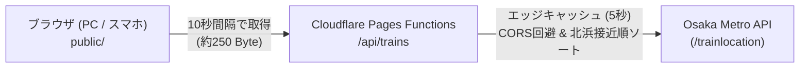

# Kitahama - 北浜駅 列車位置モニター

Osaka Metro 堺筋線 **北浜駅（K14）** を利用する乗客のための、通信量最小・超軽量なリアルタイム列車接近表示 Web アプリケーションです。  
Cloudflare Pages（Functions + 静的ファイル配信）に完全対応しています。

---

## 🌟 特徴

- **通信量最小化**:
  - Osaka Metro 公式ページ（数MBのバンドル・画像・SVG等）とは異なり、エッジ関数（Cloudflare Pages Functions）で北浜駅に必要なデータのみを抽出・加工。
  - ブラウザとの通信量は **1回あたりわずか約 200〜300 バイト**。
- **ミニマル & 高視認性 UI**:
  - 発車標（電光掲示板）スタイルのダークモード基調。
  - 「先発」「次発」「次々発」、行先（天六・北千里・高槻市・京都河原町・天下茶屋など）、現在位置（「堺筋本町に停車中」「南森町を出発」など）、編成番号を即座に把握可能。
- **上り・下りワンタップ切替**:
  - 天神橋筋六丁目・阪急線方面（上り / A）
  - 天下茶屋方面（下り / B）
- **安定性と省電力**:
  - 外部フレームワーク（React/Vue等）依存ゼロの Pure HTML/CSS/Vanilla JS。
  - 10秒ごとの自動更新（秒数カウントダウン表示付き）。
  - Page Visibility API を搭載し、バックグラウンド時は自動でポーリングを一時停止して通信と端末のバッテリー消費を抑制。

---

## 🏗 システム構成



---

## 📁 ディレクトリ構成

```text
Kitahama/
├── functions/
│   └── api/
│       └── trains.js       # Cloudflare Pages Functions (APIプロキシ & 北浜駅データ加工)
├── lib/
│   ├── stations.js         # 堺筋線・阪急線の駅名マッピング
│   └── train-tracker.js    # 北浜駅基準の列車追跡・距離計算・ソートロジック
├── public/
│   ├── index.html          # ミニマル発車標UI
│   ├── app.js              # フロントエンドスクリプト
│   └── style.css           # スタイルシート (ダークモード基調)
├── test/
│   ├── train-tracker.test.js      # ロジックの網羅的単体テスト
│   ├── edge-cases.test.js         # 異常値・フォールバック検証
│   ├── live-api.test.js           # 実際のOsaka Metro API疎通テスト
│   ├── functions-handler.test.js  # Pages Functions ハンドラーテスト
│   └── server-integration.test.js # ローカルHTTPサーバー統合テスト
├── server.js               # ローカル開発・検証用 HTTP サーバー
├── package.json
└── wrangler.toml           # Cloudflare Pages 設定
```

---

## 🚀 使い方

### 1. ローカル開発サーバーの起動

外部パッケージのインストール不要で、標準の Node.js (v18+) だけで動作します。

```bash
npm start
```
ブラウザで `http://localhost:3000` を開きます。

### 2. テストの実行

Node.js 組み込みテストランナーによる全13件のテスト（実API通信・エッジケース・統合テスト含む）を実行します。

```bash
npm test
```

---

## ☁️ Cloudflare Pages へのデプロイ手順

### 方法A: GitHub 連携 (推奨)
1. GitHub にプッシュした本リポジトリを Cloudflare ダッシュボードで選択。
2. 設定:
   - **Framework preset**: None
   - **Build command**: (空欄のままでOK)
   - **Build output directory**: `public`
3. 「Save and Deploy」をクリックするだけでデプロイ完了。

### 方法B: Wrangler CLI による直接デプロイ
```bash
npx wrangler pages deploy public
```

---

## 📜 ライセンス

MIT License
